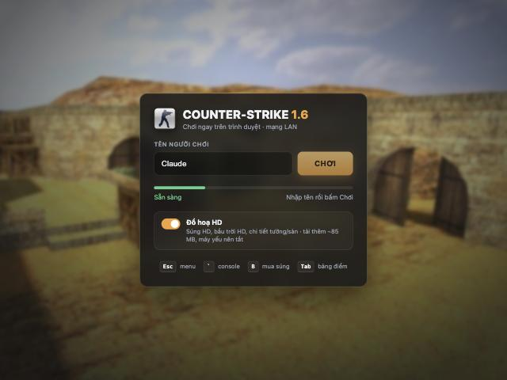
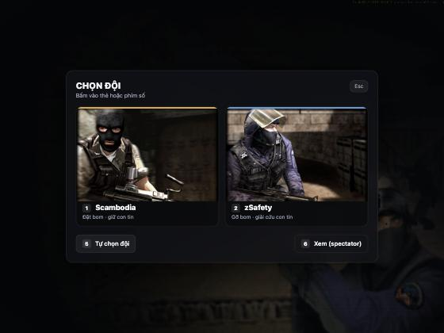
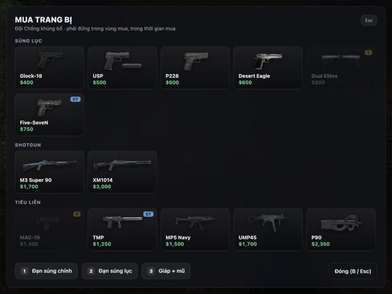
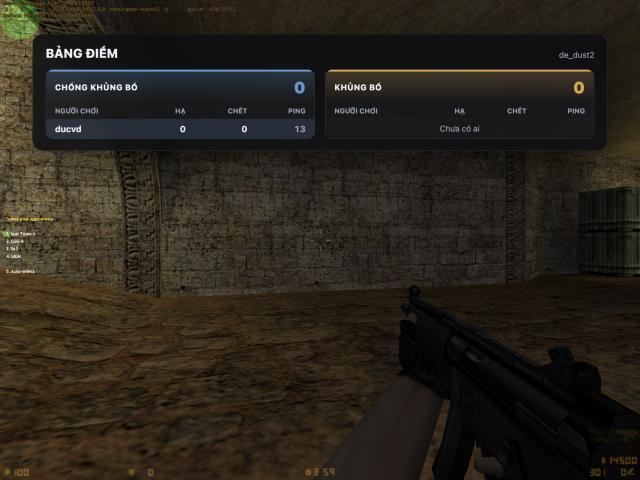
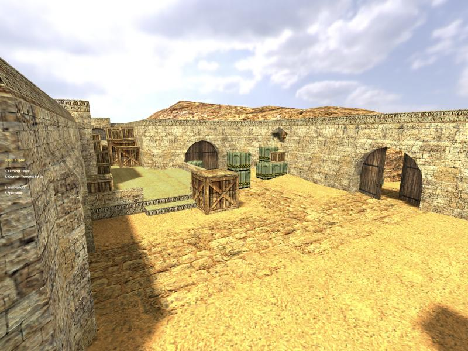

# zStrike: Counter-Scam 1.6

> Counter-Strike 1.6 chạy ngay trên trình duyệt: **zSafety** đấu **Scambodia**. Mở link, chọn phe, vào trận.

zStrike là bản CS 1.6 cho các buổi chơi LAN của team. Máy host chạy server bằng Docker; người chơi chỉ cần mở một đường link trên Chrome, Edge hoặc Firefox, không cài game, không cần Steam.



| Chọn phe | Mua trang bị | Bảng điểm |
|---|---|---|
|  |  |  |



---

## Mục lục

- [Tính năng](#tính-năng)
- [Kiến trúc](#kiến-trúc)
- [Yêu cầu](#yêu-cầu)
- [Cài đặt](#cài-đặt)
- [Vận hành](#vận-hành)
- [Cấu hình server](#cấu-hình-server)
- [Build lại client](#build-lại-client)
- [Cấu trúc thư mục](#cấu-trúc-thư-mục)
- [Mạng và xử lý sự cố](#mạng-và-xử-lý-sự-cố)
- [Hạn chế đã biết](#hạn-chế-đã-biết)
- [Bản quyền và ghi công](#bản-quyền-và-ghi-công)

---

## Tính năng

**Chơi trên trình duyệt**
- Engine **Xash3D FWGS 1.2.2** (WebAssembly) với renderer **WebGL2**. Trình duyệt kết nối tới server qua **WebRTC**.
- Server game nằm trong một container Docker, phục vụ luôn trang web ở cổng `27016`.

**Hai phe tuỳ chỉnh**
- **zSafety** (thay Counter-Terrorists) và **Scambodia** (thay Terrorists). Tên mới hiện ở thông báo trong game, chat đội, menu và bảng điểm.
- Nhân vật riêng: **Angelina** (Scambodia, số 2) và **Choi Ji Yoon** (zSafety, số 2), lấy từ Counter-Strike Online.

**Giao diện mới, viết bằng HTML đè lên game**
- Màn hình vào game có thanh tiến độ theo MB và công tắc đồ hoạ HD.
- **Chọn phe / nhân vật** (tự mở khi vào, hoặc phím `M`): thẻ có ảnh, chọn bằng chuột hoặc phím số.
- **Mua trang bị** (`B`): thẻ có ảnh súng, giá, nhãn phe; súng của phe kia bị làm mờ; mua nhanh đạn và giáp.
- **Bảng điểm** (giữ `Tab`): điểm hai phe, mạng hạ, số chết, ping; cập nhật theo thời gian thực.

**Đồ hoạ**
- Gói HD tuỳ chọn: súng HD, bầu trời HD, **detail textures** cho tường và sàn trên 13 map gốc.
- Bật sẵn `brightness 2`, lọc anisotropic 8×, vẽ theo độ phân giải màn hình (devicePixelRatio).

**Tải nhanh**
- Gói game đã rút gọn (239 MB thay vì 415 MB).
- Dữ liệu được **lưu trong trình duyệt** (IndexedDB, chia khúc 32 MB), lần sau vào gần như tức thì. Khi gói trên server đổi, trình duyệt tự tải bản mới.

**Ổn định**
- **Watchdog**: engine crash thì tiến trình tự thoát để Docker khởi động lại server.
- Client tự thoát đàng hoàng khi đóng tab hoặc khi tab bị ẩn quá 45 giây, và tự kết nối lại khi quay về.
- Script khởi động tự tìm IP LAN (bỏ qua VPN) và thử lại nếu Docker chưa mở cổng UDP.

---

## Kiến trúc

```
 Trình duyệt người chơi                              Máy host (Docker)
┌──────────────────────────────┐          ┌──────────────────────────────────────────────┐
│ index.html + menu HTML        │  HTTP    │ cs16-web-server (ghcr.io/balintsoos/...)      │
│  - tải gamefiles-lite.zip     │ ◄──────► │  :27016  web tĩnh + WebSocket /websocket       │
│  - tải hd-pack.zip (tuỳ chọn) │  27016   │          (trao đổi thông tin kết nối WebRTC)   │
│  - tải custom-pack.zip        │          │  :27018  WebRTC / UDP: dữ liệu trận đấu        │
│ Xash3D FWGS (WASM, WebGL2)    │ ◄──────► │  engine Xash3D (i386, Go wrapper)              │
│ client CS (cs16-client wasm)  │  27018   │  watchdog.sh: crash -> thoát -> Docker restart │
└──────────────────────────────┘          │  ghi log sự kiện -> server-logs/               │
                                          ├──────────────────────────────────────────────┤
                                          │ cs16-score (python:3.12-alpine)               │
                                          │  đọc server-logs/ -> live/score.json           │
                                          └──────────────────────────────────────────────┘
```

**Ba gói dữ liệu** mà trình duyệt tải (không có trong repo, xem [Cài đặt](#cài-đặt)):

| Gói | Dung lượng | Nội dung | Ai tải |
|---|---|---|---|
| `gamefiles-lite.zip` | ~239 MB | Dữ liệu CS 1.6 đã bỏ phần Half-Life không dùng, kèm `cs_mansion` | Tất cả |
| `hd-pack.zip` | ~85 MB | Model súng HD, bầu trời HD, detail textures | Ai bật "Đồ hoạ HD" |
| `custom-pack.zip` | ~3 MB | Model Angelina / Choi Ji Yoon, chuỗi tên phe | Tất cả |

**Bảng điểm**: server ghi log sự kiện (`log on`) → container `cs16-score` ([scoreboard/score.py](scoreboard/score.py)) tính điểm → `live/score.json` → trang web đọc mỗi giây khi giữ `Tab`. Ping lấy qua `rcon status`.

---

## Yêu cầu

- **Docker** (Docker Desktop trên macOS / Windows, hoặc Docker Engine trên Linux).
- **macOS**: script dùng `ipconfig`, `sips`, `lsof`. Trên Linux phần server vẫn chạy được, nhưng phải tự đặt `IP` và tự chuyển ảnh (xem [Cài đặt](#cài-đặt)).
- **Python 3** để tạo các gói dữ liệu.
- Người chơi: Chrome, Edge hoặc Firefox bản mới, **cùng mạng LAN** với host (xem [Mạng](#mạng-và-xử-lý-sự-cố)).

> Trên máy Apple Silicon, server (bản i386) chạy qua giả lập QEMU. Chạy được, nhưng tốn CPU hơn và có lỗi crash đã biết (xem [Hạn chế](#hạn-chế-đã-biết)). Máy host x86 sẽ ổn định hơn.

---

## Cài đặt

### 1. Clone

```bash
git clone https://github.com/darkknightck/zStrike.git
cd zStrike
```

### 2. Tạo gói dữ liệu game và ảnh menu

```bash
python3 scripts/build_packs.py game
python3 scripts/build_packs.py ui
```

- `game`: lấy `gamefiles.zip` từ image `ghcr.io/balintsoos/cs16-web-server`, thêm `cs_mansion.bsp`, tạo `web-ghcr/gamefiles-mansion.zip` (bản đầy đủ, cho client cũ) và `web-ghcr/gamefiles-lite.zip` (bản rút gọn).
- `ui`: chuyển ảnh súng / nhân vật (`gfx/vgui/*.tga`) sang PNG vào `web-ghcr-122/ui/`. Nếu có gói HD đã giải nén, đặt `HD_VGUI_DIR=<thư mục>/cstrike/gfx/vgui` để dùng ảnh HD.

### 3. Nhân vật tuỳ chỉnh và tên phe

Model CSO không có trong repo. Chép model vào đúng chỗ (chi tiết trong [custom/README.txt](custom/README.txt)):

```
custom/cstrike/models/player/leet/leet.mdl   <- [CSO]Angelina_customized/models/buffclass24s2tr.mdl
custom/cstrike/models/player/gsg9/gsg9.mdl   <- [CSO]Princess Choi Ji Yoon/model/buffclass24s4ct.mdl
web-ghcr-122/ui/angelina.jpg                 <- ảnh giới thiệu nhân vật (tuỳ chọn, cho menu)
web-ghcr-122/ui/choijiyoon.jpg
```

Sau đó sinh chuỗi tên phe và đóng gói:

```bash
python3 scripts/build_packs.py custom
```

> **Server và client phải dùng cùng một file model.** `docker-compose.122.yml` mount 2 model này vào server; `custom-pack.zip` đưa chúng tới trình duyệt. Thiếu model thì xoá 2 dòng mount tương ứng trong `docker-compose.122.yml`.

### 4. Gói HD (tuỳ chọn)

Cần file `ultimate_hd_pack_by_ralex_08.7z` (gói của cộng đồng, tự tải):

```bash
python3 scripts/build_packs.py hd ~/Downloads/ultimate_hd_pack_by_ralex_08.7z
```

Script chỉ lấy những gì dùng an toàn trên web:

| Lấy | Bỏ | Lý do bỏ |
|---|---|---|
| Model súng `v_` / `p_` / `w_`, khiên, đồ vật | File WAD | Đổi kích thước texture, map bị sai tỉ lệ |
| Âm thanh thay thế | File map `.bsp` | Khác map trên server, không vào được |
| Bầu trời các map có sẵn | Model nhân vật, sprites | Server kiểm tra nguyên vẹn, có thể crash |
| Detail textures (thu về 256 px) | `.exe`, `.dll`, `.bat`, plugin | Không dùng, không an toàn |

Không có gói HD thì người chơi chỉ cần tắt công tắc "Đồ hoạ HD" (hoặc mở link kèm `?hd=0`).

### 5. Chạy

```bash
MAP=de_dust2 ./restart-ghcr.sh
```

Script in ra link để gửi cho người chơi, ví dụ `http://192.168.1.20:27016`.

---

## Vận hành

### Lệnh

| Việc | Lệnh |
|---|---|
| Khởi động / khởi động lại (tự lấy IP mới) | `./restart-ghcr.sh` |
| Chọn map lúc khởi động | `MAP=de_inferno ./restart-ghcr.sh` |
| Chỉ định IP (khi tự tìm sai, vd. cắm cả dây và Wi-Fi) | `./restart-ghcr.sh 192.168.1.20` |
| Quay về client cũ của image (engine 1.0.x) | `CLIENT=old ./restart-ghcr.sh` |
| Dừng | `docker compose -f docker-compose.ghcr.yml -f docker-compose.122.yml down` |
| Xem log server | `docker logs -f cs16-web-server` |
| Xem bảng điểm thô | `cat web-ghcr-122/live/score.json` |

### Trong game

| Phím | Chức năng |
|---|---|
| `M` | Chọn phe / nhân vật |
| `B` | Mua trang bị (phím `1` `2` `3`: đạn chính, đạn phụ, giáp + mũ) |
| `Tab` (giữ) | Bảng điểm |
| `Esc` | Menu của engine (Console, Configuration, …) hoặc đóng menu HTML |
| `` ` `` | Console |

**Đổi map khi đang chơi** (gõ trong console):

```
rcon_password cs16lan
rcon changelevel de_nuke
```

Map có sẵn: de_dust2, de_dust, de_inferno, de_nuke, de_train, de_aztec, de_cbble, de_chateau, de_piranesi, de_prodigy, de_storm, de_survivor, de_torn, de_vertigo, de_airstrip, cs_office, cs_italy, cs_assault, cs_militia, cs_havana, cs_747, cs_backalley, cs_estate, cs_siege, cs_mansion, as_oilrig.

### Thêm / đổi nhân vật

1. Model phải là GoldSrc `.mdl` v10 (CS 1.6). Model CSO dùng được nếu có đủ hoạt ảnh của người chơi CS.
2. Chọn một nhân vật gốc để thay (`terror`, `leet`, `arctic`, `guerilla`, `urban`, `gsg9`, `sas`, `gign`), chép file thành `custom/cstrike/models/player/<tên>/<tên>.mdl`.
3. Thêm dòng mount vào `docker-compose.122.yml` (giống 2 dòng có sẵn).
4. Đổi tên và ảnh thẻ trong `CLASSES` ở [overlay.ts](web-ghcr-122/src/client-src/overlay.ts), rồi `./scripts/build-client.sh`.
5. `python3 scripts/build_packs.py custom` rồi `./restart-ghcr.sh`.

---

## Cấu hình server

[cstrike/server.cfg](cstrike/server.cfg):

| Cài đặt | Giá trị | Ghi chú |
|---|---|---|
| `mp_startmoney` | 16000 | Ai cũng đủ tiền mua mọi thứ |
| `mp_buytime` | 9 | Phút được mua đầu ván |
| `mp_friendlyfire` | 1 | Bắn trúng đồng đội |
| `rcon_password` | `cs16lan` | **Công khai**: menu HTML dùng để lấy ping. Đổi và gỡ khỏi client trước khi đưa ra Internet |
| `mp_consistency` | 0 | Tắt kiểm tra file model: client web kẹt ở bước này với model tuỳ chỉnh |
| `log on` | | Ghi log sự kiện cho bảng điểm |

---

## Build lại client

Mã nguồn client nằm ở [web-ghcr-122/src](web-ghcr-122/src). Bản gốc là client của [balintsoos/cs16-web-server](https://github.com/balintsoos/cs16-web-server), đã sửa nhiều.

```bash
./scripts/build-client.sh
```

Script build trong Docker (`node:24-alpine`), không cài gì lên máy, rồi chép kết quả vào `web-ghcr-122/`. Người chơi bấm F5 là nhận bản mới; không cần khởi động lại server.

**Những gì đã sửa so với bản gốc**

| File | Thay đổi |
|---|---|
| `engine.ts` | Dùng `xash3d-fwgs@1.2.2` + renderer `webgl2`; nạp dll CS theo tên `.wasm`; truyền tham số ở cấp trên để giữ `-ref webgl2`; chuyển log engine cho phần khác dùng |
| `gamefiles.ts` | Tải gói kèm tiến độ, cache IndexedDB theo khúc 32 MB, kiểm tra phiên bản bằng HEAD; gói HD và gói tuỳ chỉnh |
| `main.ts` | Nạp 3 gói theo thứ tự (gốc → HD → tuỳ chỉnh), `extras.pk3` (font menu), lệnh đồ hoạ, tự thoát khi đóng / ẩn tab |
| `overlay.ts` | Menu chọn phe / nhân vật / mua súng, bảng điểm |
| `index.html`, `style.css`, `desktop.ts` | Giao diện mới thay cho kiểu Windows XP |
| `xash.wasm` (vá lúc build) | Chuỗi `host_ver`: bản npm có số build -1, client CS đòi ≥ 4190 |
| `cs/client_emscripten_wasm32.wasm` | Vá sẵn các chuỗi tên phe viết cứng trong client CS |

---

## Cấu trúc thư mục

```
zStrike/
├── restart-ghcr.sh            # khởi động / khởi động lại server (tự tìm IP, kiểm tra UDP)
├── docker-compose.ghcr.yml    # server game (image balintsoos) + watchdog
├── docker-compose.122.yml     # client mới, các gói dữ liệu, model tuỳ chỉnh, bảng điểm
├── cstrike/server.cfg         # cấu hình server
├── custom-maps/cs_mansion.bsp # map tuỳ chỉnh
├── custom/                    # model + tên phe (model không có trong repo)
│   ├── README.txt
│   └── rename_teams.py        # CT -> zSafety, T -> Scambodia
├── scoreboard/score.py        # đọc log server -> live/score.json
├── server/watchdog.sh         # entrypoint: engine crash -> thoát -> Docker restart
├── scripts/
│   ├── build_packs.py         # tạo gamefiles-lite / ui / custom-pack / hd-pack
│   └── build-client.sh        # build lại client web
├── web-ghcr-122/              # client đang dùng (bản build + mã nguồn trong src/)
├── web-ghcr/                  # client cũ đã vá + nơi chứa các gói .zip (không commit)
├── docs/                      # ảnh, ghi chú hiệu năng, README của dự án gốc
└── docker-compose.yml, start.sh, web/, proxy/, ...   # dự án gốc cs16-web (image yohimik, đã bị gỡ)
```

---

## Mạng và xử lý sự cố

Cần mở: **TCP 27016** (trang web), **TCP + UDP 27018** (WebRTC). WebRTC cần đường UDP trực tiếp, nên **Cloudflare Tunnel hay ngrok không dùng được**.

| Triệu chứng | Nguyên nhân thường gặp | Cách xử lý |
|---|---|---|
| Người chơi không mở được trang (`curl` ra `000`) | Wi-Fi công ty chặn kết nối giữa các máy (ping được nhưng TCP bị chặn) | Dùng chung một mạng khác: hotspot điện thoại, router riêng; hoặc nhờ IT mở cổng |
| Mở được từ cùng Wi-Fi, không mở được từ dải mạng khác | VPN split-tunnel trên máy host đẩy gói trả lời vào VPN | Tắt VPN trên máy host |
| Vào trang được, kẹt sau khi bấm Chơi | UDP 27018 bị chặn, hoặc Docker chưa mở cổng UDP | Chạy lại `./restart-ghcr.sh` (script tự kiểm tra UDP) |
| Đổi mạng xong không ai vào được | IP trong server vẫn là IP cũ | `./restart-ghcr.sh` để lấy IP mới, gửi lại link |
| Mọi người bị ngắt cùng lúc ~10 giây | Server crash, watchdog đang khởi động lại | Bấm F5 vào lại |
| Kẹt ở "Fetching game files" | Trình duyệt hết dung lượng lưu trữ | Xoá dữ liệu trang rồi tải lại; hoặc mở bằng `?hd=0` |
| Không thấy bản client mới | Trình duyệt còn giữ trang cũ | F5, hoặc Ctrl/Cmd + Shift + R |

Kiểm tra từ máy người chơi:

```bash
nc -vz -w 3 <IP host> 27016
```

---

## Hạn chế đã biết

- **Server crash khi ngắt người chơi mất kết nối** (`double free or corruption`) lúc còn người khác đang chơi. Lỗi nằm trong lớp WebRTC (Go) của image balintsoos; không build lại được vì mã engine đã bị xoá khỏi GitHub. Đã giảm bằng watchdog và client tự thoát đàng hoàng.
- **Trên Apple Silicon**, server chạy qua giả lập QEMU (Rosetta không hỗ trợ 32-bit).
- **Docker Desktop đôi khi không mở lại UDP 27018** sau khi tạo lại container liên tục; `restart-ghcr.sh` tự thử lại.
- **Không có menu VGUI** trên bản web, nên menu và bảng điểm được làm lại bằng HTML. Một số chữ trong game vẫn bị cắt, ví dụ "Scambo…" ở bảng chế độ xem.
- `rcon_password` đang công khai trong client: chỉ dùng trong LAN.
- `mp_consistency 0`: server không chặn người chơi tự sửa model.

---

## Bản quyền và ghi công

- **Counter-Strike** và **Half-Life**: game, map, model, âm thanh thuộc **Valve Corporation**. Repo **không** chứa nội dung game của Valve; người dùng tự tạo các gói dữ liệu bằng `scripts/build_packs.py`.
- **Nhân vật Angelina, Choi Ji Yoon**: từ **Counter-Strike Online** (Nexon), bản do cộng đồng chỉnh sửa. Không có trong repo.
- **Ultimate HD Pack by ralex**: gói của cộng đồng, không có trong repo.
- **Engine**: [Xash3D FWGS](https://github.com/FWGS/xash3d-fwgs) và bản WebAssembly `xash3d-fwgs` trên npm của **yohimik**.
- **Client CS**: [cs16-client](https://github.com/Velaron/cs16-client) (Velaron), bản Emscripten lấy từ image Docker.
- **Server và client web gốc**: [balintsoos/cs16-web-server](https://github.com/balintsoos/cs16-web-server) (MIT).
- **Dự án gốc cs16-web**: README cũ ở [docs/LEGACY-cs16-web.md](docs/LEGACY-cs16-web.md).

Dự án nội bộ, phi thương mại, phục vụ chơi LAN giữa những người sở hữu Counter-Strike. Không liên kết với Valve, Nexon hay các dự án nêu trên. Sử dụng với trách nhiệm của bạn.
